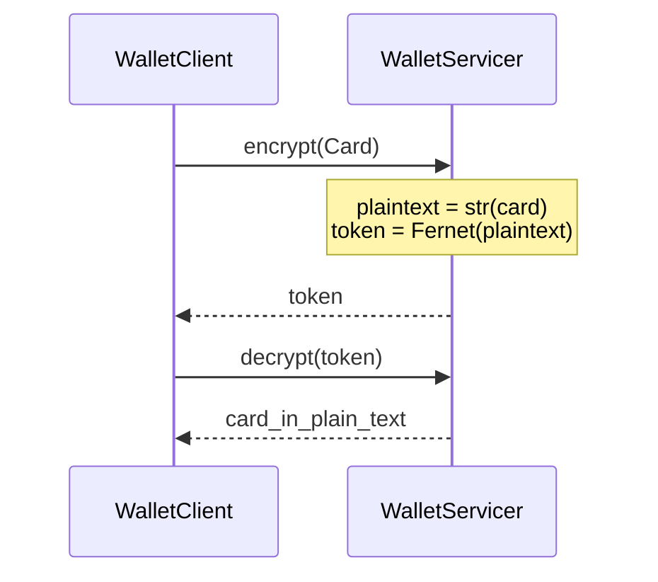

# gRPC wallet (CMPE 273 midterm)

[](https://github.com/pranavprem/cmpe273-midterm/actions/workflows/ci.yml)

A small Python service that encrypts a payment card with [Fernet](https://cryptography.io/en/latest/fernet/) and decrypts the token back to the card's protobuf text form. The client is a class, the server is a process, and there is no web UI.

## Original context

This is [Pranav Prem](https://github.com/pranavprem)'s midterm for **CMPE 273, Enterprise Distributed Systems**, at San José State University. The repository was created on May 24, 2017, with the description "Google Proto + GRPC + Encryption/decryption" and a single commit, `working code for mid-term`.

CMPE 273 is a course on application protocols for large-scale distributed systems. The published catalog description covers object request brokers, asynchronous messaging, and web services, plus a lab that uses those protocols to build systems. This midterm is the gRPC slice of that work.

The README that shipped in 2017 was an assignment sheet: install `grpcio-tools` and `cryptography`, generate Python from `wallet.proto`, fill in the `TODO` sections, run `python server.py`, and check the result with `python -m test`. The implementation below is that completed assignment, brought up to a current Python.

It is a class exercise. The channel has no TLS, the encryption key lives only in the server process, and the sample number `4012888888881881` is a well-known Visa test PAN (it passes the Luhn check). The 2017 tests used that same number.

## How it works

`wallet.proto` defines a `Wallet` service with two RPCs, `encrypt` and `decrypt`. Names are lowercase because that is how the assignment proto was written.



1. `WalletClient.encrypt` takes a dict with `card_holder_name`, `card_number`, and `card_expiry_yyyymm`, builds a `Card`, and sends a `CardEncryptRequest` on an insecure gRPC channel.
2. The server encrypts `str(card)` as UTF-8. That string is the protobuf text format. On the Python 2 this was written for, `bytes(card)` produced the same text. Decrypt returns that text in `card_in_plain_text`.
3. For the sample card the text is 87 bytes, so the Fernet token (version, timestamp, IV, PKCS7-padded ciphertext, HMAC, then URL-safe base64) is **204 characters**. Two encryptions of the same card differ because Fernet uses a fresh IV.
4. `decrypt` checks the HMAC and returns those bytes as `card_in_plain_text`.
5. `WalletServicer` generates its Fernet key in memory. The same process can decrypt what it encrypted. A restart cannot. Tokens from another process raise `InvalidToken`, which gRPC reports as status `UNKNOWN`.

Sample plaintext, which is also what decrypt returns:

```text
card_holder_name: "Foo Bar"
card_number: "4012888888881881"
card_expiry_yyyymm: 201804
```

Proto3 omits fields left at their defaults, so an empty `Card` encrypts as an empty string. A quote in a name is escaped by the text format (`Foo "Bar"` becomes `"Foo \"Bar\""`).

## Tech stack

| Piece | Used here |
| --- | --- |
| Language | Python 3.11+ (CI runs 3.11, 3.12, and 3.13) |
| RPC | gRPC, `grpcio` 1.84, insecure channel, one worker thread |
| Messages | Protocol Buffers 7, generated from `wallet.proto` |
| Encryption | `cryptography` 50, Fernet (AES-128-CBC with HMAC-SHA256) |
| Tests | `unittest` in `test.py` |
| Lint / format | Ruff 0.17 |
| CI | GitHub Actions, `.github/workflows/ci.yml` |

`grpcio` and `cryptography` publish wheels, so a C compiler is not required.

## Project structure

```text
.
├── wallet.proto           # Wallet service definition (unchanged contract)
├── wallet_pb2.py          # Generated messages. Do not edit.
├── wallet_pb2_grpc.py     # Generated stub and servicer. Do not edit.
├── server.py              # WalletServicer, create_server(), and the process entrypoint
├── client.py              # WalletClient
├── test.py                # unittest suite. Starts its own server.
├── requirements.txt       # Pinned runtime dependencies
├── requirements-dev.txt   # Runtime deps plus grpcio-tools and ruff
├── pyproject.toml         # Ruff configuration
├── .github/workflows/ci.yml
├── AGENTS.md              # Guide for coding agents
└── CLAUDE.md              # Points at AGENTS.md
```

The generated files are checked in so `python server.py` works after installing `requirements.txt`. Protoc writes a banner that says `NO CHECKED-IN PROTOBUF GENCODE`. That banner is stock wording from the generator. These copies are committed on purpose.

## Run it today

Use Python 3.11 or newer.

```sh
python3 -m venv .venv
source .venv/bin/activate
python -m pip install -r requirements-dev.txt
```

`requirements.txt` is enough if you only want to run the server. The dev file adds the code generator and Ruff.

### Tests

From the repository root. The gRPC tests bind `127.0.0.1` on an ephemeral port and start their own server.

```sh
python -m unittest test -v
```

`python test.py` and `python -m test` also work when the current directory is this repo. Prefer `python -m unittest test`. Python ships a standard-library `test` package, and `python -m test` only hits this file because the repo root is on `sys.path`.

### Server

```sh
python server.py
```

```text
Server started at...3000
```

Stop it with Ctrl-C. `WALLET_HOST` and `WALLET_PORT` override the default `0.0.0.0:3000`. The default listens on all interfaces, with no authentication.

In another shell, with the same virtualenv and the repo root on `PYTHONPATH` (or just `cd` here):

```python
from client import WalletClient

client = WalletClient()  # 0.0.0.0:3000
encrypted = client.encrypt(
    {
        "card_holder_name": "Foo Bar",
        "card_number": "4012888888881881",
        "card_expiry_yyyymm": 201804,
    }
)
print(len(encrypted.token))  # 204
print(client.decrypt(encrypted.token).card_in_plain_text)
```

The token changes on every call. Decrypt only works against the server process that created it.

### Checks

```sh
ruff check .
ruff format --check .
```

### Regenerate the stubs

Only needed if `wallet.proto` or the pinned `grpcio-tools` / `protobuf` versions change. Then reinstall `requirements-dev.txt` and run:

```sh
python -m grpc_tools.protoc -I. --python_out=. --grpc_python_out=. wallet.proto
```

The 2017 instructions used `python -m grpc.tools.protoc`. That module path is gone. `wallet_pb2_grpc.py` refuses to import on a `grpcio` older than the version it was generated with (1.84.0). `wallet_pb2.py` refuses a `protobuf` older than 7.35.1.

## License

This repository does not include a license. Adding one is the owner's decision.
